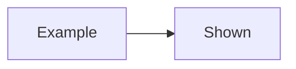
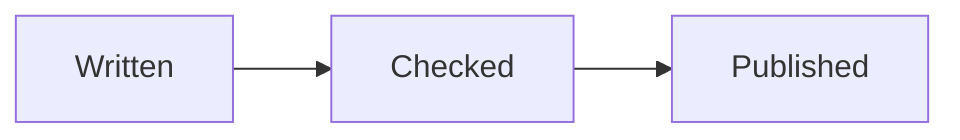

# The release guide

How a page goes live. An example of the syntax, which is not the diagram:

````markdown

````

The flow itself:



And a second one, which is not imported:

~~~mermaid
pie
  "A" : 1
~~~
